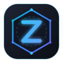

<p align="center">
  
</p>

# ZeroEnclave — Zero-Knowledge Password & Media Enclave

<p align="center">
  <a href="https://github.com/ewceniza9009/zeroenclave/releases/latest">
    
  </a>
  <a href="https://github.com/ewceniza9009/zeroenclave/releases/latest/download/ZeroEnclave-v1.2.9.apk">
    
  </a>
  <a href="LICENSE">
    
  </a>
</p>

**ZeroEnclave** is a standalone, local-first, zero-knowledge password manager, encrypted media vault, and cross-device sync enclave engineered in pure **Go**.

This repository is the **official open-core architecture showcase and public Android distribution hub** for ZeroEnclave. It contains the cryptographic format specifications, Android JNI bridge definitions, UI design tokens, and official Android release packages.

---

## Downloads (Android Release)

The production-signed release APK is available directly on GitHub Releases:

👉 **[Download ZeroEnclave-v1.2.9.apk](https://github.com/ewceniza9009/zeroenclave/releases/latest/download/ZeroEnclave-v1.2.9.apk)** *(40.3 MB)*

* **Dual-Architecture Support:** Built with Android NDK 27 for both `arm64-v8a` (smartphones & tablets) and `x86_64` (emulators & Chromebooks).
* **Self-Contained Enclave:** Embedded native Go cryptographic core and local loopback HTTP service. No third-party analytics, tracking, or cloud lock-in.
* **Requirements:** Android 8.0 (Oreo / API 26) or higher.

---

## What's New in v1.2.9

* **Appearance & Theme System (Midnight OLED, Deep Slate & Clean Light):**
  * **Midnight OLED Mode:** Pure `#000000` canvas for maximum battery savings and contrast on OLED phone, tablet, and laptop displays.
  * **Deep Slate:** Professional neutral dark theme with layered surface elevation.
  * **Clean Light Mode:** Daylight aesthetic with soft ambient elevation, zero dark-card anomalies, and WCAG-compliant high-contrast typography.
  * **6 Vivid Accent Palettes:** Electric Blue (Default), Emerald Crypt, Amethyst Vault, Cyber Amber, Crimson Sentinel, and Titanium Slate.
* **Clean Light Mode Overhaul & Readability:**
  * **Zero Black Card Artifacts:** All credential cards, security metrics, and modal dialogs render on crisp daylight surfaces.
  * **Markdown Studio Daylight Theming:** Fenced code blocks, table structures, and callout banners maintain high contrast in light mode.
  * **Form Helper Micro-Actions:** Redesigned `Generate Ed25519 Key` and `Generate Password` buttons with smooth border radii and daylight contrast.
* **Complete Emoji Sweep & Precision Vector Iconography:**
  * Replaced all emoji symbols with cohesive Lucide/Feather vector SVGs adhering to strict UI Craft design standards.
* **Mobile & Tablet Detail View Contrast:**
  * Navigation back controls (`← Items`) and item hero titles feature crisp dark typography across tablets and mobile viewports.

---

## Repository Architecture & Showcase (20% Open Core)

This public repository exposes key technical components of the ZeroEnclave platform:

```
zeroenclave/
├── spec/
│   └── crypto/
│       ├── cipher.go       # Argon2id KDF, AES-256-GCM AEAD, and Secret Key derivation
│       ├── stream.go       # 1VBLOB binary specification (64KB chunked envelope encryption)
│       └── generator.go    # Cryptographically secure random password & passphrase generator
├── mobile/
│   ├── cmd/
│   │   └── main.go         # CGO / JNI bridge exporting Go vault server to Android JVM
│   └── android/
│       └── MainActivity.kt # Android Kotlin host activity, WebView client & biometric prompt
├── ui/
│   ├── style.css           # UI Craft design token engine (OLED, Deep Slate, Clean Light)
│   └── logo.svg            # Vector branding emblem
├── LICENSE                 # MIT License
└── README.md
```

---

## Security Architecture

* **Key Derivation (KDF):** **Argon2id** (memory: 64 MB, time: 3 iterations, 4 parallelism threads) to defeat GPU/ASIC brute-force attacks.
* **Vault Index Encryption (AEAD):** **AES-256-GCM** authenticated encryption with random 96-bit nonces per commit.
* **Streaming Media Blob Encryption (`1VBLOB\x01`):**
  * **Per-File Envelope Encryption:** Random 256-bit File Encryption Key (FEK) generated via `crypto/rand` per attachment.
  * **Chunked AEAD:** 64 KB ($65,536\text{ B}$) chunks sealed with AES-256-GCM (`12B` nonce = `8B prefix || 4B chunk index`; `9B` AAD = `8B chunk index || 1B final-chunk flag`) preventing chunk reordering or truncation attacks.
  * **$\mathcal{O}(1)$ Video Seeking:** Supports HTTP `Range` requests (`206 Partial Content`) by seeking directly to chunk offset on disk (`19 + i × 65552`).
* **Dual-Layer Protection (Secret Key):** Combines user Master Password with an emergency 128-bit Secret Key (`A3-XXXXXX-XXXXXX-...`).
* **Active Defense & Anti-Coercion:**
  * **Anti-Coercion Duress Vault:** Configure a secondary decoy password opening a harmless dummy vault.
  * **2-of-3 Shamir Secret Sharing (`GF(256)`):** Split the Secret Key into 3 cryptographic shares where any 2 reconstruct your key and 1 reveals zero information.
* **Breach Protection:** Integrated k-anonymity checks against the HaveIBeenPwned API (transmits only first 5 SHA-1 hash characters, never passwords).

---

## Device Linking & Pairing

1. **On your primary device:** Open **Cloud & Sync** to display your unique pairing **QR Code**.
2. **On your secondary device (Smartphone or Tablet):** Tap **"📷 Scan QR to pair this device"** on the welcome screen.
3. **Scan & Unlock:** Point your camera at the desktop screen. The Secret Key and sync configuration populate automatically.

---

## License

This project is licensed under the [MIT License](LICENSE).
Official releases and binary assets are copyrighted by Erwin Wilson Ceniza.

